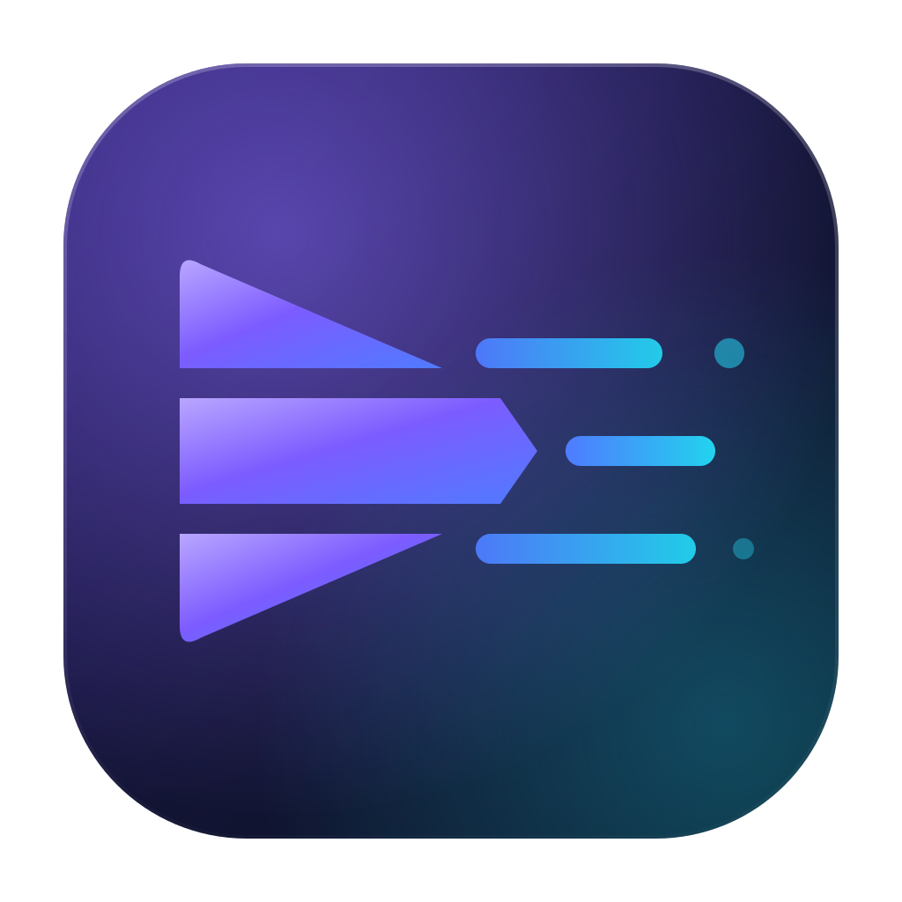

<p align="center"></p>

<h1 align="center">GoEncode</h1>

<p align="center">Remux, encode and transcode media files with ffmpeg, on Windows, macOS, Linux and Android.</p>

GoEncode is a front end for ffmpeg, written in Go with [giode](https://github.com/xmhrnx/giode).
Add any number of files and pick one set of settings. GoEncode applies those settings to every file
in the batch: video, audio, subtitles, chapters, metadata and output naming.

## Features

- **All of ffmpeg's encoders.** At startup GoEncode reads what the installed ffmpeg can do
  (`ffmpeg -codecs`, plus `-h encoder=…` for each encoder). Every codec and encoder that ffmpeg
  has is offered. The common ones (x264, x265, SVT‑AV1, libaom, rav1e, VP9, ProRes, DNxHR,
  FFV1, AAC, Opus, MP3, FLAC, AC‑3 and others) have curated settings.
- **Copy or remux.** Each kind of stream can be copied untouched, so moving a file into a new
  container takes seconds and loses no quality. If a stream can't go into the chosen container,
  GoEncode converts or drops it depending on your setting.
- **Only valid choices.** Each container accepts certain codecs, and each encoder supports certain
  pixel formats and sample rates. GoEncode shows only what fits the current container and codec.
  When you change the format, settings that no longer apply are fixed for you.
- **Simple and advanced modes.** Simple mode has one-click presets (Universal MP4, HEVC, AV1,
  GPU, WebM, remux, ProRes, GIF, MP3, Opus, FLAC), a quality slider and a resolution choice.
  Advanced mode shows every setting of every encoder: GoEncode's curated options first, then
  everything else ffmpeg reports.
- **Explanations on hover.** Every option has an ⓘ popover that explains what it does for the
  chosen codec.
- **Preview.** Encode 5–60 seconds from any point in a file. You get the encoding speed, the
  clip size, a projected size for the whole file, and the same frame from the source and the
  result side by side.
- **Hardware acceleration.** Supports NVIDIA NVENC, Intel Quick Sync, AMD AMF, Apple VideoToolbox,
  VA‑API, Media Foundation, Android MediaCodec, V4L2 M2M and D3D12. Each one is test-encoded at
  startup, so GoEncode only offers the ones that work on your machine.
- **Batches.** Drag and drop files or folders, encode up to 4 files at once, follow per-file and
  overall progress, cancel or retry files, and get a notification when the batch finishes.
- **Blu-ray and DVD folders.** A disc, or a copy of one, is added as one file: its main title,
  the longest Blu-ray playlist or the largest DVD title set, with its parts joined in order. Blu-ray
  tracks get their languages from the disc's playlist.
- **Tracks per file.** Keep all audio and subtitle tracks, the first, or those in chosen languages,
  or switch a file's tracks on and off one by one.

## Getting ffmpeg

GoEncode drives the `ffmpeg` and `ffprobe` programs; it doesn't link ffmpeg. It looks in these
places, in this order:

1. The location set in **Preferences** (the program or its folder).
2. The folder that holds the GoEncode executable.
3. Common install folders (Homebrew, MacPorts, Chocolatey, `C:\ffmpeg\bin`).
4. `PATH`.

Install ffmpeg with `winget install ffmpeg`, `brew install ffmpeg` or `sudo apt install ffmpeg`,
or put the two programs next to GoEncode. On Android, ffmpeg is packaged inside the APK by
`android/build-ffmpeg.sh`, which the release workflow runs. iOS doesn't allow apps to run other
programs at all. [docs/ffmpeg.md](docs/ffmpeg.md) covers both.

## Developing

You need Go 1.26+ and the [giode CLI](https://github.com/xmhrnx/giode-cli).

```bash
go run .
```

```bash
go run . "path/to/movie.mkv"
```

```bash
go test ./...
```

```bash
giode build windows-installer dmg deb android
```

`go test -short ./...` skips the tests that need a real ffmpeg. Without `-short`, the integration
tests generate sample media and run real encodes.

To inspect the running app, start it with `GIODE_MCP=1`. giode then serves screenshots, the UI
tree and input on `127.0.0.1:7600/mcp`.

[docs/architecture.md](docs/architecture.md) explains how the code is organized.


## License

GoEncode is licensed under the [Apache License 2.0](LICENSE). ffmpeg is a separate program with
its own license: the Android build from `android/build-ffmpeg.sh` includes x264 and is GPL, and
the ffmpeg you bundle on desktop carries whatever license its build has.
